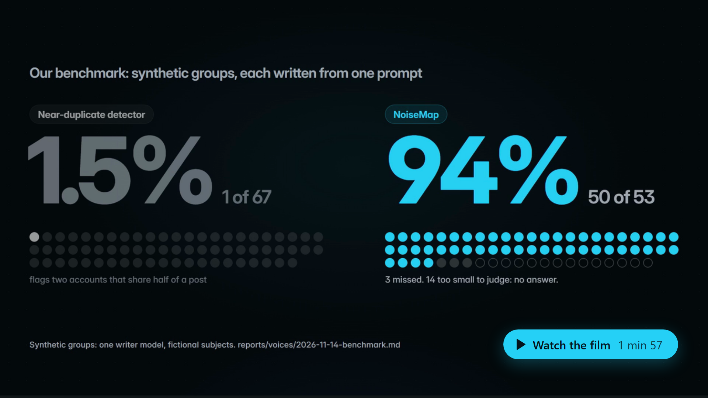
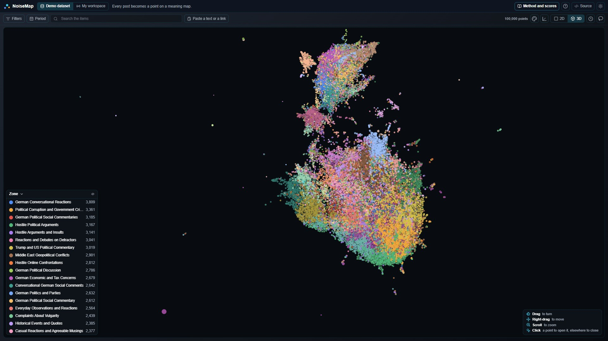
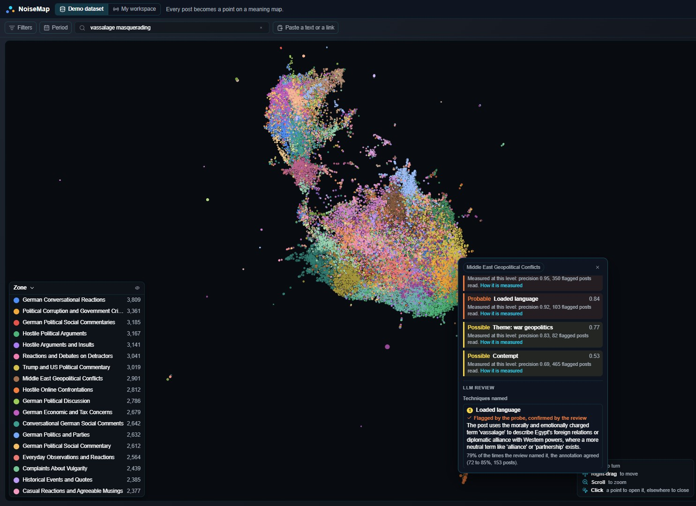
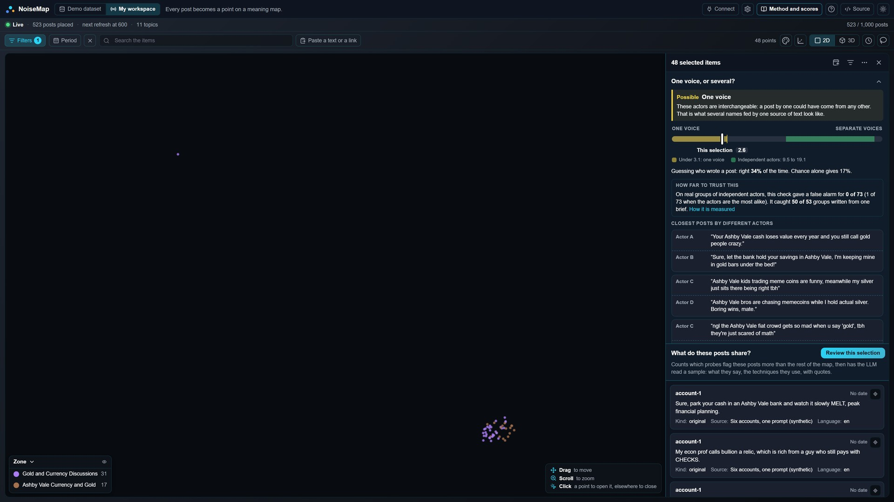

# NoiseMap

**Bot farms no longer copy a text. They copy a prompt.**

NoiseMap is an API that places every post on a map of meaning. You see what is being said, who is saying it, and whether the crowd saying it is real or fake.

By Team Lowkey, for the Hostinger challenge "Decode the Noise" at [Junction 2026](https://2026.hackjunction.com/) (Espoo, 13 to 15 November 2026).

| Live demo | Pitch film | Pitch deck | Method and measures |
| :---: | :---: | :---: | :---: |
| [noisemap.srv2160938.hstgr.cloud](https://noisemap.srv2160938.hstgr.cloud) | [Watch (1 min 57)](https://www.youtube.com/watch?v=Hc7838hy1qk) | [PDF, 11 pages](docs/pitch/noisemap-deck.pdf) | [Method page](https://noisemap.srv2160938.hstgr.cloud/method) |

[](https://www.youtube.com/watch?v=Hc7838hy1qk)

*The pitch film: 1 min 57, narrated, with captions. Click the image to watch it.*

## The problem

Six accounts, six different posts, nobody copied anybody: one prompt wrote them all. On our benchmark, a near-duplicate rule finds 1.5% of such groups (1 of 67). NoiseMap finds 94% (50 of 53 it can read), and wrongly flags 1 of the 73 hardest real groups.

IP addresses, devices and posting hours can be bought. What a campaign cannot avoid is saying something. So NoiseMap reads the words.

## What it does



- **Map of meaning.** Each post is embedded once (EmbeddingGemma, open weights) and drawn as a point. Posts that mean the same thing sit together. The zones are named by topic.
- **Probes.** A probe is a tiny linear classifier on the meaning vector. 71 were trained on about 30,000 annotated posts and tested on accounts they never saw. Only the 36 that passed (60% precision or more on test) are shown.
- **LLM review.** Gemini reads again what a probe flags, or any post or selection you pick. It names the manipulation technique and must quote the exact words. A quote that is not in the post is rejected.
- **One voice, or several?** Real people each have a voice: you can guess who wrote what. Accounts fed by one prompt do not: shuffle who wrote what and nothing changes. Test any selection; the answer shows the posts it rests on.

| A post, its probes and the LLM review | "One voice, or several?" on six synthetic accounts |
| :---: | :---: |
|  |  |

A verdict never comes alone. It comes with what was found, where, and how reliable that detector measured to be.

## What we measured

Every figure below comes from a report in this repository. Intervals are 95% confidence intervals.

| Detector | Measure | Report |
| --- | --- | --- |
| **One voice** (6 accounts x 6 posts) | Flags 94% of the groups written from one prompt (50 of 53; 85% to 98%). Wrongly flags 1 of the 73 hardest real groups (0% to 7%) and 0 of 73 random real groups | [`reports/voices/2026-11-14-benchmark.md`](reports/voices/2026-11-14-benchmark.md) |
| Near-duplicate rule, as a baseline | Finds 1.5% of the same groups (1 of 67) | same report |
| One voice, harder cases | One persona per account: 11 of 14. A real troll operation (Internet Research Agency): 9 of 17 groups of one team, 9 of 69 of another | same report |
| **Probe** "political content", level probable | Precision 95% (92% to 97%), recall 62%, false-positive rate 1.7%. Rare labels: recall often under 15% | [`docs/probes/report.md`](docs/probes/report.md) |
| **LLM review**, 12 techniques, 1,200 random test posts | Precision 78.0% (73.0 to 82.4), recall 48.1%, false-positive rate 0.5% | [`reports/review/2026-11-15-review-v2.md`](reports/review/2026-11-15-review-v2.md) |
| **Cascade** on loaded language: probe, then review | 73.8% precise after the probe, 93.2% (87.8 to 96.5) after the review; 265 flagged test posts read | [`reports/review/2026-11-15-cascade-bands.md`](reports/review/2026-11-15-cascade-bands.md) |

All 36 probes, with their intervals, are on the [Method page](https://noisemap.srv2160938.hstgr.cloud/method).

## When it is wrong

- **Base rates.** If 1 group in 100 is coordinated, a one-voice alert on 6 accounts x 6 posts is right 4 times in 10 (28% on 4 x 4). So the product says "possible", never "bot", and shows why.
- **Three outcomes.** Flagged, not flagged, "not enough evidence": under 4 accounts with 4 posts each, the check abstains.
- **Known false alarms, listed.** Newsrooms covering the same event; a declared campaign kit.
- **Limits we state.** Labels come from models (a stronger model re-read 883 test posts and confirmed 86% of the yes answers); no human has read the test posts yet. The scripted groups are synthetic. An operator who gives each account its own subject passes the check. The LLM review is measured against a model annotation, not human gold; 4 techniques get no figure (the annotators disagree); its review of a selection is not measured.

## Try it

Open <https://noisemap.srv2160938.hstgr.cloud>.

1. Look at the map: 48 zones, named by topic.
2. Raise it with a probe, then click a post: its probes, their measured reliability, the LLM review with quotes.
3. Lasso a group and press "Check this selection".

Your own data: open "My workspace", or send one call per post. The answer carries the probes that flagged it and where it lands among your other posts.

```
curl -X POST https://noisemap.srv2160938.hstgr.cloud/api/v1/items \
  -H "Authorization: Bearer $NOISEMAP_API_KEY" \
  -H "Content-Type: application/json" \
  -d '{"id":"post-1","text":"Fuel prices are up again and nobody in charge seems to care.","created_at":"2026-11-14T09:31:07Z","actor_id":"user-42","kind":"original"}'
```

The key comes with the workspace, which the site creates in one click, without an account. The full reference is on the Method page; the contract is [`backend/ingest/schema.py`](backend/ingest/schema.py).

## Live on Hostinger

Everything served runs on one KVM 2 VPS (2 vCPU, 8 GB, no GPU): the API, the web app, and EmbeddingGemma in an Ollama container. The LLM is called through the **Hostinger AI Router**; a pasted link is read by Context.dev. Measured on the live server ([`docs/hostinger.md`](docs/hostinger.md)): one post through the API in 0.17 to 0.38 s; 200 new posts placed on a map in 25.6 s.

The demo map shows 100,000 posts from X, a sample of the public dataset [`SinclairSchneider/tweets_sample_2026`](https://huggingface.co/datasets/SinclairSchneider/tweets_sample_2026) (nearly all dated January to July 2026): every post of 38,088 actors the probes never trained on, a seeded draw except 26 accounts kept on purpose for the demonstration.

## Partner technologies

- **Gemma (Google DeepMind): one open model is the whole perception layer.** EmbeddingGemma turns each post into a vector, once. Every map point, every probe and the one-voice check read that vector. The same open weights ran on GPUs for the corpus and run live on the 2 vCPU server, with no GPU and no paid call.
- **Gemini API (Google DeepMind): the reader of a cascade, not a chatbot.** A score cannot be checked; a quote can. Probes rank every post at almost no cost; Gemini (gemini-3.8-flash, through the Hostinger AI Router) reads what they flag, names the technique and quotes the exact span, which our code checks. It also named the 48 zones.
- **Verda: the corpus a laptop could not embed.** Three A100 GPU instances embedded 4.4 million posts in 5.5 hours; the live map and the probes come from them. Run log and failures: [`reports/verda.md`](reports/verda.md).

How each partner technology is used, in detail: [`docs/tech-challenge-status.md`](docs/tech-challenge-status.md).

## What is here

| Path | Content |
| --- | --- |
| [`frontend/`](frontend/) | The web app: React, TypeScript, Vite, deck.gl. The point cloud in 2D and 3D, colour by attribute, legend, filters, search, time window, lasso, neighbours by meaning |
| [`backend/`](backend/) | The API: FastAPI. Loads one map build at start-up; serves typed arrays, item content, search by words and similarity by meaning; stores and reads the posts of a workspace |
| [`pipelines/`](pipelines/) | Offline steps that make a map build: ingest, embed, layout, neighbours, zones, pack |
| [`deploy/`](deploy/) | Images and the Compose stack of the server |
| [`.github/workflows/ci.yml`](.github/workflows/ci.yml) | Checks, image build and deploy, on CRACI runners |
| [`reports/`](reports/) | Evaluation reports and their metrics, the run log of the pipeline, the account of the Verda runs |
| [`docs/`](docs/) | The brief, the probe report and annotation guides, research, Hostinger notes, the pitch deck and screenshots ([`docs/pitch/`](docs/pitch/)) |

## Run it locally

Needs [uv](https://docs.astral.sh/uv/), Node.js 22 and [Ollama](https://ollama.com/) with `ollama pull embeddinggemma:300m-qat-q8_0`.

```
cp .env.example .env

# 1. Make a small map build under data/build/ (downloads the dataset on first run)
uv run --group pipelines python -m pipelines.ingest --help

# 2. API on :8000, serving data/build/current
uv run uvicorn backend.main:app --port 8000

# 3. Web app on :5173, proxying /api to the API
cd frontend && npm install && npm run dev
```

Checks:

```
uv run ruff check . && uv run ruff format --check . && uv run pytest
cd frontend && npx tsc -b && npm run build
```

## How it is deployed

A push to `main` runs the checks on CRACI runners, builds the two images there, copies them to the Hostinger VPS over SSH and starts the stack ([`deploy/docker-compose.yml`](deploy/docker-compose.yml)): the API, the static web app and an Ollama container with EmbeddingGemma, published by the Traefik proxy that the server already runs. Map builds are made offline and copied to the server; they never go through git.

## Licence

[MIT](LICENSE). All code in this repository was written during the event.
