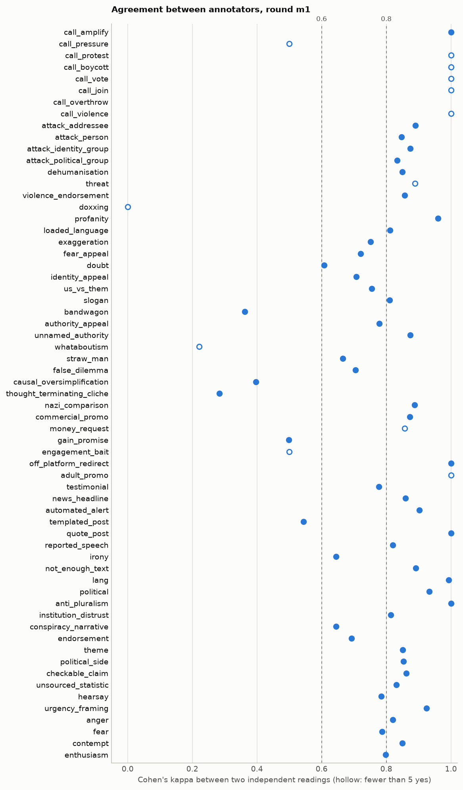
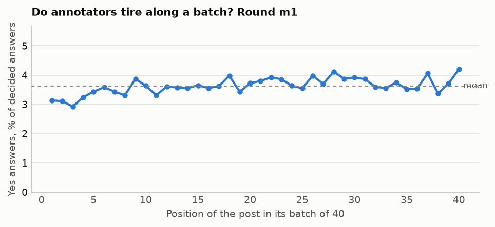
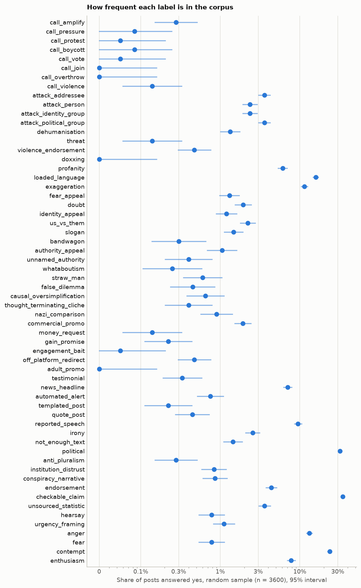

# Probes on the X corpus: method and results

Run `{{run}}`, 15 Nov 2026. Labels come from Claude Haiku 5.5 annotators and were audited on a sample by Claude Opus 5.5. No person has read the test posts yet (§11).

This file is generated by `pipelines/probes/report.py` from `report.template.md`: the text is written by hand, every table is built from the files of the campaign. The order in which things were run, and each decision, is in [`journal.md`](journal.md).

## 1. Summary

- **What was done.** {{note:campaign}} by independent annotators, each following a written guide. Probes were trained on the train split, their thresholds placed on the calibration split, and each one measured once on the test split. Actors, and texts, never cross a split.
- **Outcome.** {{note:states}} A probe is *shown* when at least one of its two levels reaches 60% precision on test, on at least 30 posts read, and a second reader confirms at least 70% of the labels it is measured against.
- **What works.** Language, topic, political content, checkable claims, format (quotes, templates, alerts), emotion, profanity, commercial promotion and the hostility labels all have a shown level. Among calls: `call_boycott` at both levels, `call_vote` and `call_amplify` at `possible`.
- **What does not, yet.** The other calls (`call_pressure`, `call_join`, `call_violence`), `threat` and nine more probes rank their label hundreds of times above chance but stay under the bar: they are review-only. `call_protest`, `engagement_bait` and `hearsay` are dropped. `call_overthrow` and `doxxing` had too few positives to fit a probe.
- **Read the recall column.** For most rare labels a shown level flags the head of the scores: precise, and catching a small share of the positives. Where the random test sample holds few positives the recall interval is wide, and the table says so.
- **How far the labels can be trusted.** {{note:audit}} Two probes lost their shown state on that audit.
- **About the vector.** The signal is linear: an MLP and k-NN do no better than the linear probe. 256 dimensions beat 128 and 64 nearly everywhere, and the curve has not flattened.

## 2. What a probe is

A probe is a linear classifier on the vector of a post. At runtime it is: standardise the vector with a fixed mean and scale, one dot product, a bias. It costs nothing next to the embedding, so every post of a corpus gets a score for every probe.

- One probe per target. A target is a yes/no label, or one value of a label that has its own answers (`lang:en`, `theme:sport`, `political_side:left`).
- Vectors: {{model_key}}. A probe is only ever applied to vectors of that key.
- A probe flags; it does not convict. It gives two levels, `possible` and `probable`, each tied to a precision measured on posts it never saw.

## 3. Data

The corpus is a sample of X posts collected by sweeping a vocabulary of search terms: it is not a random sample of X, and nothing in it is labelled. Three shards of it had vectors when this campaign ran.

{{table:pool}}

- **Split by actor.** The split of a post is a hash of its actor id: 60% train, 20% calibration, 20% test. An actor is on one side only, in every shard.
- **No text across splits.** A text is normalised (lower case; links, mentions and numbers masked) and kept once per split. A text found in several splits is kept in one, picked by its own hash. Copies are common in this corpus, and a copy on each side of a split is leakage.
- **Long posts are left out.** Posts over 1,500 characters are not labelled and not measured: the probes are untested on them.

So every rate below is a rate over distinct texts of 1,500 characters at most, in a keyword-swept corpus.

## 4. Labels

The 63 labels are listed in [`taxonomy.md`](taxonomy.md). Three rules shaped the list:

- **One label, one closed question, decided on the text alone.** The annotator sees neither the author, nor the date, nor the post that was answered: exactly what the vector was made from.
- **No label needs to know what is true**, who someone really is, or what the author intends.
- **Composite notions are derived, never annotated.** "Radical right" is a side crossed with a radicality criterion, each annotated on its own.

The instructions are in [`guides/`](guides/): common rules, then one guide per annotation pass. Every label has the same template: the question, the conditions that must all be true for a yes, the list of cases that are a no, and examples of both. Examples are invented, never taken from the corpus.

Three answers are allowed. `yes`: every condition is visibly met. `no`: the default. `unclear`: only when deciding needs something the text does not show, when the language cannot be read, or when the text is cut. A yes on most labels must quote the exact span of the post that shows it.

## 5. Annotation

### 5.1 Annotators

Annotators are Claude Haiku 5.5 agents. A workflow starts one fresh agent per batch of 40 posts. The agent reads three files (the common rules, the guide of its pass, its batch) and returns a typed answer: one value per label and per post, plus the quoted spans.

Sixty-three labels are not asked at once. They are split into nine passes, one per family, each with a short guide. A post is read by nine different agents, one per pass.

### 5.2 What keeps a reading independent

| Risk | What is done |
| --- | --- |
| An annotator learns what the labels are for | The agent type used does not receive the project's instruction files. Its whole input is the two guides and the batch |
| One label pulls another (a post judged hostile also gets "loaded language") | One pass per family: an agent never sees the labels of another family, nor any other answer |
| Two readings copy each other's context | Each pass and each reading shuffles the round on its own seed: two readings of a post share neither its neighbours nor its position |
| The annotator knows why a post was drawn | Batches mix posts drawn at random, by enrichment and by score band. No score, no stratum, no split is shown |
| The annotator expects a share of yes | The guide says a batch can have none, and that `no` is the default |
| A post gives orders to the annotator | The guide says a post is data; the agent has no tool but reading its three files |
| Reading follows the probe | Annotators never see a probe score; probes never see a calibration or test label |
| The guide is tuned on the posts it is measured on | Guides were developed on train posts only, and frozen before any calibration or test post was read |

### 5.3 Checks on every answer

- **Completeness.** A batch is taken only if every post is answered exactly once. An incomplete batch is read again.
- **Quoted evidence.** A yes that must quote the post is kept only if its quote is in the post (case and spacing aside). Otherwise the answer is thrown away: it counts as no reading.
- **Typed output.** Each answer is one of the allowed values: the agent cannot return free text in place of a label.

### 5.4 Readings and how they are settled

- Train posts are read once. Random label noise costs a linear probe little; what it cannot absorb is a systematic error, which is what the guides are for.
- Calibration, test and enrichment posts are read twice, by different agents. When the two readings differ on a label, the post is read a third time and the majority decides. With no majority the answer is `unclear` and the post is left out for that label.

{{table:rounds}}

### 5.5 How the guides were developed

A pilot of 240 train posts was read twice with the first version of the guides. Every disagreement on the weaker labels was read by hand, a cause was named for each family of disagreements, and the guides were corrected (version 2). The causes and the corrections are listed in the journal. The guides were then frozen.

The effect is measured on posts the pilot never saw:

{{table:pilot_effect}}

The pilot figures rest on 240 posts and a handful of yes answers: read them as a direction, not as a size. Seven of the nine corrected labels moved up. `doubt` and `endorsement` did not: for `doubt` the closed list of forms did not settle what counts as an insinuation, and for `endorsement` counting every named person widened the label.

### 5.6 Agreement between two readings

Measured on the calibration and test posts of the main round, which were all read twice under the frozen guides.



{{table:agreement}}

"Positive agreement" is the share of yes answers that the other reading confirms. It is steadier than kappa for rare labels. "Thrown away" is the share of answers lost to a missing or wrong quote.

{{note:agreement}}

- **Low agreement on four fallacies.** `whataboutism`, `thought_terminating_cliche`, `bandwagon` and `causal_oversimplification` are under 0.5. They were annotated to test an LLM later. As they stand they are not a usable reference: their guides need the same work the other families got.
- **Rare labels.** For a label with fewer than ten yes answers, a kappa moves a lot on one post. Their agreement is better read on the enriched rounds, where positives exist: kappa was 0.80 to 1.00 on every call label there (journal, 20:59).
- **One reading against the settled answer.** On the posts read two or three times, the first reading alone differs from the settled answer on {{note:noise}}. That is the label noise to expect in the train posts, which were read once.

### 5.7 Does the position in the batch matter?



{{note:position}}

Annotators do not tire: they warm up. The first posts of a batch get fewer yes answers, then the rate settles. Positions are shuffled and differ between two readings of a post, so this adds noise to a reading, not a bias tied to content. It was not corrected. A cheap fix for a later campaign: put a few throw-away posts at the head of each batch.

## 6. How frequent each label is

Share of yes among the posts of the main round, all drawn at random. This is the only place where a rate of the corpus is read directly.



{{table:prevalence}}

Three orders of magnitude separate the labels. A third of the posts are `political` or hold a `checkable_claim`; every call label is under 0.5% of the posts, and four of them were not seen once in 3,600 random posts. This is what shapes the rest of the method: a rare label cannot be trained, calibrated or measured on a random sample of this size.

## 7. Training

### 7.1 Enrichment

Most labels are too rare to learn from random posts. Train posts likely to carry a label are therefore searched for, in the train split only, and read by annotators like any other post.

Four searches were run, each over a fresh draw of 500,000 train posts:

| Round | How posts were found | Labels | Posts |
| --- | --- | --- | --- |
| `e1` | Cosine to the closest YES example of the label's guide | 34 | 3,400 |
| `e2` | Score of a first probe fitted on what `m1` and `e1` gave | 32 | 3,200 |
| `e3` | Cosine to the closest positive already found, or guide example | 32 | 3,200 |
| `e4` | Score of a second search probe | 13 | 1,300 |

For each label, 70 posts are drawn among the 300 best and 30 among ranks 300 to 3,000: the second group gives the near misses a probe must learn to reject. Search probes are fitted down to 4 positives; they only find posts, and are never measured.

Where the positives of each label came from:

{{table:enrichment}}

The guide examples are in English, so the first search found mostly English posts. Rare labels are therefore learnt mostly from English.

Enrichment biases train on purpose. Nothing measured on train is a rate of the corpus, and no threshold is set there.

### 7.2 Model

- Standardisation with the mean and scale of 200,000 random train vectors, the same for every probe.
- L2 logistic regression with balanced class weights. The strength is chosen among five values by cross-validation in five folds grouped by actor, on out-of-fold average precision.
- A target with fewer than 25 positives in train is not fitted.

{{table:training}}

The last three columns are other readers of the same vectors, scored the same way: cosine to the mean positive (the baseline a probe must beat), k-NN, and an MLP with one hidden layer.


{{note:readers}}

Two readings of this. The signal these labels leave in the vector is linear: a heavier reader buys nothing, which is good news for a 2 vCPU server. And similarity to examples is not a detector: a trained probe is far ahead of the cosine to the mean positive on every target.

### 7.3 Would more data help?


{{note:learning}}

A curve that still rises says that more labelled posts would help. A flat low curve (`doubt`, `irony`, `hearsay`) says they would not: either the label is annotated too inconsistently, or the vector does not carry it.

### 7.4 Is the served vector size enough?


{{note:dims}}

The curve is still rising at 256, the size the server holds. The full 768 dimensions of the model were not tested: it is the first thing to try, against three times the memory.

## 8. Thresholds

A threshold cannot be read from train, which is enriched, and the random calibration sample holds too few positives of a rare label. So calibration is read by score band:

1. The calibration posts are ranked by score. Bands are cut at ranks 100, 300, 1,000, 3,000, 10,000 and 30,000.
2. For a label with fewer than 40 positives in the random calibration sample, 25 posts are drawn uniformly in each band and read twice.
3. In a band, the posts read are a uniform sample of it. Its positive rate times its size gives its positives. Summing bands gives precision, recall and false-positive rate at any band edge.
4. A threshold may only sit on a band edge. `probable` is the deepest edge where measured precision is at least 85%, `possible` the deepest where it is at least 65%; each needs 20 posts read above it and an interval whose low end is within 15 points of the target.

Few candidate thresholds means little is fitted to noise. What is left of that optimism is removed by the test split.

{{table:thresholds}}

Two adjustments were made on calibration, before any test post was read for the labels concerned:

- Eight labels close to the bar got 50 more posts read in each of their two top bands (round `c2`). The rule did not change; four of them gained a `possible` level.
- The targets derived from `lang` use stricter targets, 98% and 95%: a language probe gates abstention and splits every measure, and the vector separates languages almost perfectly (see §11 for when this was decided).

## 9. Results on test

Each probe is measured once, at the thresholds frozen above, on test posts it never touched.

- **Posts read.** The random test sample (1,200 posts), plus, for each probe read by band, 100 posts drawn in each flagged band and 60 just under the lower threshold. A probe with no level gets 50 posts drawn among its 100 highest scores instead. All are read twice, and a third time where two readings differ.
- **Precision** is read on the flagged posts.
- **Recall and false-positive rate** need the posts that were not flagged. For a rare label the random sample holds few or no positives there, so their intervals are wide. The interval says so; the point value alone would not.
- **Intervals** are 95%, from the Jeffreys posterior of each band's rate, propagated by simulation.

### 9.1 What makes a probe shown

Three rules, each fixed before the numbers it applies to were read, except the last (§11):

1. A level is kept when its precision on test is at least 60% on at least 30 posts read. A level under the bar is withdrawn if the probe has another level that passes.
2. A probe with no kept level is *review-only* when it still ranks far above chance: average precision at least three times the prevalence on the random test sample, or a precision whose 95% interval starts at 25% or more among the posts read at the head of its scores. Otherwise it is *dropped*.
3. A shown probe becomes review-only when a second, stronger reader confirms fewer than 70% of at least 10 of the yes answers it is measured against (§9.7).

{{table:states}}


### 9.2 Shown probes, level by level

{{table:results_shown}}

"Precision if 1% were positive" translates the measured recall and false-positive rate to a corpus where the label has that base rate.

### 9.3 Levels withdrawn on test

These levels met their target on calibration and fell under the bar on test. This is the optimism of a threshold picked at the edge of its target, and the reason test exists.

{{table:withdrawn}}

### 9.4 Probes with a level, not shown

{{table:results_other}}

`dehumanisation` and `news_headline` pass the bar and are here because of the second opinion (§9.7). The others are under the bar, or were read on fewer than 30 posts.

### 9.5 Probes with no level: what the head of their scores holds

For a probe that got no threshold, 50 posts were read among its 100 highest-scored test posts, out of 452,310.

{{table:heads}}

A label seen two or three times in 1,200 random posts fills about half of its probe's top 100. That is not a verdict a user can be shown, and it is a strong filter for a review pass.

### 9.6 Ranking quality, every fitted probe

Average precision on the random test sample. Chance is the prevalence of the label. A probe with fewer than 5 positives in that sample has no value here.


{{table:ranking}}

### 9.7 By language

The corpus has no language column. The probes `lang:en` and `lang:de`, trained on the language the annotators named, give the language of every post. Against the annotators on the random test sample they are right on {{note:language_probe}}

Yes answers over posts read, in the band of each kept level, by language:

{{table:languages}}

Counts outside English are small for most rare labels: read a row with fewer than 20 posts in a language as untested there.

### 9.8 A second opinion on the labels

Every number above is measured against the answers of the Haiku annotators. To see how far those answers hold, test posts read in the flagged bands of each shown probe were read again by Claude Opus 5.5, with the same guides and the same blind protocol: for each probe, up to 15 posts settled as yes and 15 settled as no.

{{note:audit}}

{{table:audit}}

- Where the second reader confirms nearly every yes, the precision above stands.
- Where it confirms fewer, the Haiku annotators say yes more readily than a stricter reader, and the measured precision is an upper reading. `dehumanisation` and `news_headline` are under 70% and are not shown. `fear_appeal`, `exaggeration`, `us_vs_them` and `loaded_language` are between 70% and 80%: their precision against a strict reader is lower than the table says.
- Neither reader is the truth. A person reading the same sheets settles it (§11).

### 9.9 On the build the site shows

The demo build is {{note:demo}}, all written by actors of the test split: no probe was trained or calibrated on a post it holds. The server scores it from the exported pack when it starts. The same sum was done offline, to check that each probe flags there the share it flagged on test.


{{table:demo}}

The shares match the test for every probe. The largest gaps are on rare labels, where a share is a few dozen posts. A probe that flagged several times its test share would point at a shift between the test sample and the build: none does.

## 10. Errors read

For each shown probe, up to 30 of its false positives on test were read: posts it flagged and the annotators settled as no. They were read and sorted by a second model (Claude Opus 5.5), not by a person. Examples are paraphrased: no post of the corpus is quoted.

| Mode | Meaning |
| --- | --- |
| Label error | On a strict reading of the guide the post is a yes: the annotators missed it |
| Near miss | Close to the label, but a NO rule of the guide applies: reported not done, target not named, figurative |
| Topic | The subject or the vocabulary of the label, without the behaviour |
| Short or no context | Too short, or undecidable without what it answers |
| Language | Not in English, and that seems to be the cause |

{{note:errors}}

{{table:errors}}

What stands out:

- **Most false positives are near misses.** The behaviour is close and one rule of the guide says no: the author's own act instead of a request, a target that is not named, criticism of an act rather than of a person, a named source, a comment added to a headline or to a quotation.
- **Some probes lean on words.** `dehumanisation` fires on a few animal and parasite words used loosely; `fear` fires on words for "terrible" and on "I fear" used as a hedge; `quote_post` fires on quotations that carry the author's own remark.
- **Label errors point at the guides.** For `attack_identity_group` most of them turn on one question the guide leaves open: whether an ableist insult is a slur for a disability group. For `commercial_promo` and `enthusiasm`, the annotators said no to posts that meet the conditions as written. Each is a line to add to a guide before the next campaign.

These tags are one model's single reading. They are firmest on the labels with a mechanical test, and softest on `loaded_language`, `us_vs_them`, `fear_appeal`, `contempt` and `enthusiasm`.

One example per probe, for its most frequent mode:

{{table:error_examples}}

What the product does with this:

- A **near miss** is what the review pass is for: the probe flags, the LLM reads the post against the guide's NO rules and quotes its evidence.
- A **label error** means the measured precision is too low a reading for that probe, not too high.
- A **topic** error is the confound to watch at group level: a swarm about a subject would raise the rate of a probe that leans on that subject. The rate of a class in a group must be compared with the rate in its own zone, never with the corpus.

## 11. Limits

- **The reference is a model.** Labels are the majority of two or three Haiku readings, audited on a sample by Opus. No person has read the test posts. `pipelines/probes/audit_sheet.py` writes the same audit as a sheet for a person (883 posts, one question each, the settled answer hidden) and scores it once filled; a person's reading then replaces the model's audit for the probes it covers.
- **Recall is low and uncertain for rare labels.** A shown level of a rare label flags a few posts in ten thousand. What is missed below the threshold is bounded by a random sample of 1,200 posts, which holds almost none of them.
- **Thresholds sit on band edges.** That keeps them from fitting noise and makes them coarse: `lang:de` stops at 75% recall because the next edge was too far.
- **Calibration is optimistic at the margin.** Two levels were withdrawn on test, and three probes with one level fell under the bar. The levels that passed were also selected by passing: expect a point or two less on new posts.
- **Rules set after seeing numbers.** The language targets (98% and 95%) replaced the general ones after a first test reading showed the general rule gave a language probe wrong one time in eight; the language probes were then measured a second time on the same random test posts. The 70% bar of the second opinion was set after the audit was read.
- **This corpus only.** Three shards of 73 of a keyword-swept sample, distinct texts, 1,500 characters at most. No other platform, period or corpus was tried: untested off-distribution. A pasted article is not a post.
- **English first.** Guide examples are in English and the first search for rare labels found mostly English posts.
- **Train posts were read once.** The first reading differs from the settled answer on {{note:noise}} where both exist.
- **Position in the batch.** Annotators say yes less often on the first four posts of a batch. Not corrected.
- **Four fallacy labels are not a reference yet.** Their agreement is under 0.5.
- **The full vector was not tried.** 256 dimensions are served; the model gives 768.
- **Group rates are not built.** Comparing the rate of a label in a swarm with its zone needs the measured false-positive rate and recall to correct the raw flag rate. One lead from another experiment of this project: on synthetic posts, subtracting from each vector the mean vector of its topic barely changes the reading of one post and clearly improves the reading of a group of 16 (`docs/brief-recovery/1-field-probes.md`). Untested with these probes.

What to do next, in order of expected gain: a person reads the audit sheets; a second run with hard negatives mined from the head of each review-only probe; the 768-dimension vectors; a larger random test sample for the call and solicitation passes only, to bound their recall.

## 12. Reproduce

```
uv run --group pipelines python -m pipelines.probes.pool --builds tweets-2026-s00 tweets-2026-s54 tweets-2026-s72
uv run --group pipelines python -m pipelines.probes.sample --round m1 --train 1600 --calibration 800 --test 1200 --seed 2
uv run --group pipelines python -m pipelines.probes.batches --round m1 --readings a b
# annotation: one agent per batch (journal.md), then
uv run --group pipelines python -m pipelines.probes.collect --round m1 --journal <workflow journal>
uv run --group pipelines python -m pipelines.probes.merge --round m1
uv run --group pipelines python -m pipelines.probes.enrich --name e1 --labels <labels>
uv run --group pipelines python -m pipelines.probes.train --run v1 --rounds m1 e1_calls ...
uv run --group pipelines python -m pipelines.probes.diagnose --run v1 --rounds m1 e1_calls ...
uv run --group pipelines python -m pipelines.probes.bands --name c1 --run v1 --split calibration --labels <labels>
uv run --group pipelines python -m pipelines.probes.calibrate --run v1 --rounds m1 c1_calls ...
uv run --group pipelines python -m pipelines.probes.bands --name t1 --run v1 --split test --labels <labels>
uv run --group pipelines python -m pipelines.probes.evaluate --run v1 --rounds m1 t1_calls ...
uv run --group pipelines python -m pipelines.probes.figures --round m1 --run v1
uv run --group pipelines python -m pipelines.probes.figures_results --run v1
uv run --group pipelines python -m pipelines.probes.report --run v1 --round m1
```

Seeds are fixed in the code (`SEED` in `train.py`, the seed of each draw in the journal). Labels are not reproducible bit for bit: an annotator is a language model. What is reproducible is everything after the labels.
